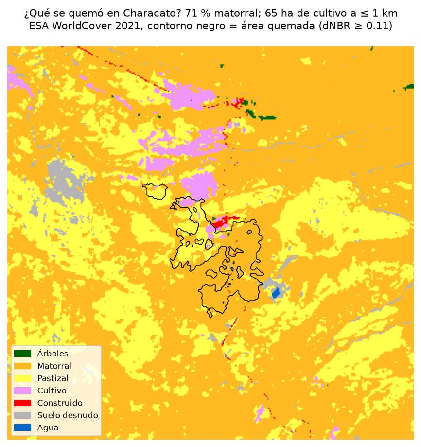
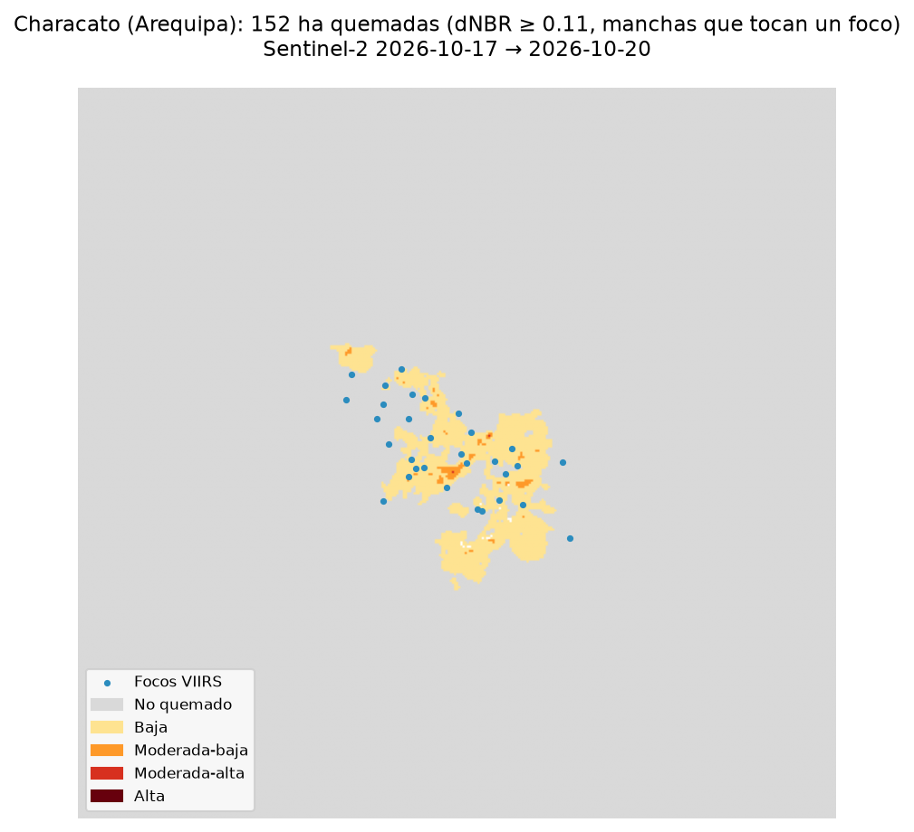

# ¿Qué se quemó? Incendios y chacras en el Perú, octubre 2026

Sesión 14 · Ciencia de Datos con Python · Nicolás Silva Andújar (@nicosil02) · reto **C (¿qué se quemó?)**

**Página web:** https://claude.ai/artifact/QQcz7dxPZ7NF5BUwVzEYPF (copia en [`docs/index.html`](docs/index.html))



## Pregunta

Cuando arde un incendio en el Perú, ¿qué es lo que se quema: pastizal, matorral o chacras? ¿Y cuántas chacras quedan cerca del fuego? Lo respondo para el incendio de **Characato (Arequipa)** del 18 y 19 de octubre de 2026.

## Tres hallazgos

1. **Lo que ardió fue sobre todo matorral, pero el fuego llegó al borde de las chacras.** Se quemaron **196 ha** (dNBR ≥ 0,10): 67 % matorral, 23 % pastizal y **17 ha de cultivo (8,5 %)**, sobre todo en el borde norte, donde empieza la campiña. A 1 km o menos de la cicatriz quedan **104 ha de cultivo** y 11 ha construidas sin quemar.
2. **El umbral de siempre casi no ve este incendio.** Con dNBR ≥ 0,27 salen solo **6 ha**. El 97 % de lo quemado es de severidad baja (Key y Benson, 2006): en el matorral seco hay poca vegetación que perder y el índice cambia poco aunque el fuego pase. Por eso la cifra principal usa 0,10.
3. **Las nubes deciden qué incendios se pueden medir.** De seis incendios de la sierra probados, cuatro (Tapo, San Juan de Jarpa, Cayna y Vilcas Huamán) no tuvieron ninguna imagen Sentinel-2 limpia después del fuego, y en Caja la mejor tenía el 27 % de la zona tapada ([`candidatos_caso.csv`](data/processed/candidatos_caso.csv)). Characato se pudo medir porque Arequipa sigue despejada en octubre.

En todo el Perú hubo **7 198 focos** limpios y **2 173 incendios** en la semana (171 activos al corte); Ucayali, Junín y Huánuco concentran la mitad de los focos.



## Datos y fechas

| Dato | Fuente | Fechas |
|---|---|---|
| Focos de calor VIIRS (S-NPP, NOAA-20, NOAA-21) | NASA FIRMS, CSV «South America 7d» | 15 al 22 oct 2026, corte 22 oct 01:22 (Lima) |
| Imágenes | Sentinel-2 L2A, Microsoft Planetary Computer | antes 17 oct, después 20 oct 2026 (99,9 % válido en la zona) |
| Cobertura del suelo | ESA WorldCover 2021, 10 m, Planetary Computer | 2021 |
| Límites distritales | [juaneladio/peru-geojson](https://github.com/juaneladio/peru-geojson) | — |

## Método

1. **Focos → incendios** (`src/01_incendios.py`): focos del Perú sin confianza baja ni volcanes (Sabancaya, Ubinas, Misti); los que están a ≤ 1 km y ≤ 48 h forman un incendio. Huella = unión de píxeles de 375 m (no es área quemada).
2. **Área quemada** (`src/02_dnbr.py`): escenas elegidas por el % de píxeles válidos en la zona según la capa SCL, no por la nubosidad de la escena. NBR = (B8A − B12)/(B8A + B12) en reflectancia (restando el +1000 de la baseline ≥ 04.00), dNBR = NBR antes − NBR después, máscara de nubes, sombra, agua y nieve. Se cuenta lo quemado a ≤ 1,5 km de algún foco.
3. **¿Qué se quemó?** (`src/03_que_se_quemo.py`): área quemada × WorldCover (clase más frecuente a 20 m) y cobertura a ≤ 1 km de la cicatriz.
4. **Página web** (`src/04_web.py`): rellena `web/plantilla.html` con las cifras y genera `docs/index.html`.

Reproducir:

```bash
python -m venv .venv && .venv/Scripts/pip install -r requirements.txt
# bajar a data/raw/ los tres CSV de 7 días de FIRMS y distritos.geojson
python src/01_incendios.py
python src/02_dnbr.py 971          # id del incendio de Characato
python src/03_que_se_quemo.py
python src/04_web.py
```

## Limitaciones

- **Un foco de calor no es un incendio forestal**: incluye quemas agrícolas y de pastos.
- **En cultivo, el dNBR también sube con la cosecha o el arado**, así que las 17 ha de cultivo quemado son un máximo.
- **WorldCover es de 2021** y en la sierra confunde chacras con pastizal.
- **Umbral 0,10**: el secado de la vegetación puede sumar algo de falso quemado; lo acota que la imagen de antes es de un día antes del fuego y que solo cuento lo que está cerca de los focos.
- **Un solo incendio**: las nubes no dejaron medir los otros candidatos de la sierra.
